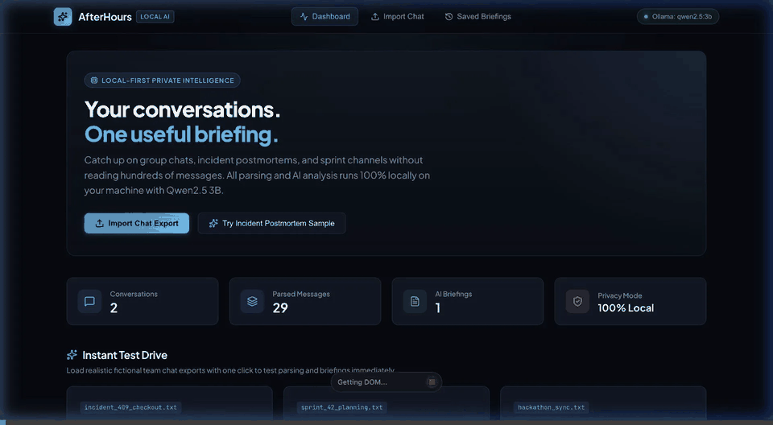
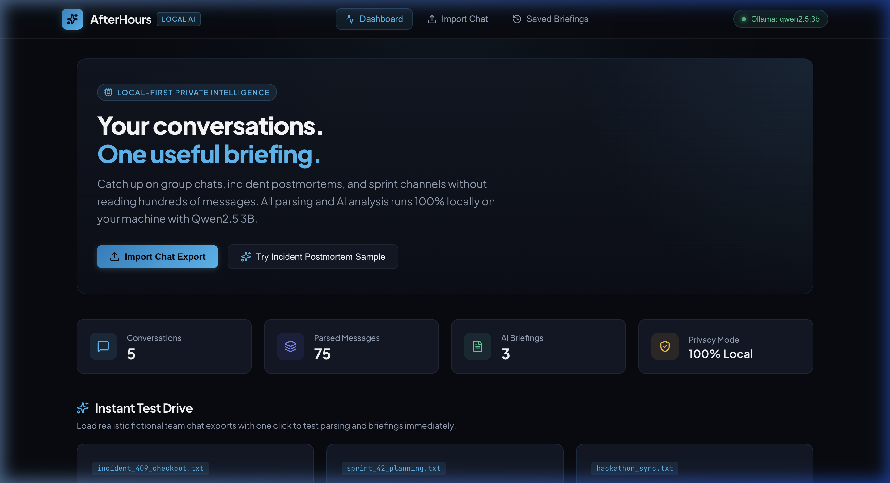
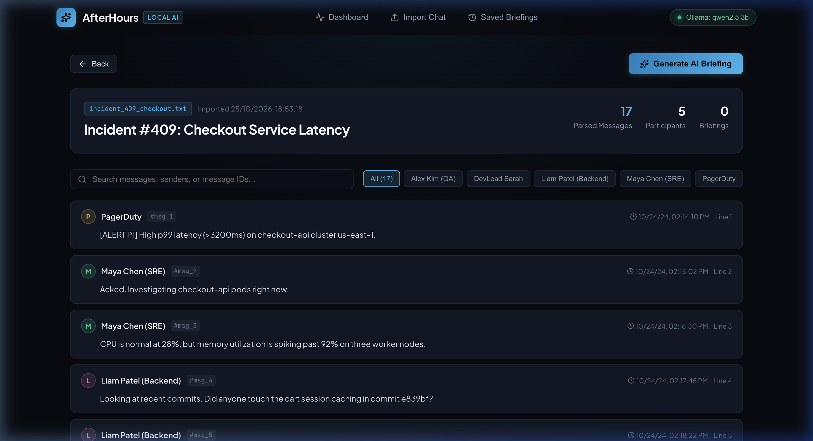
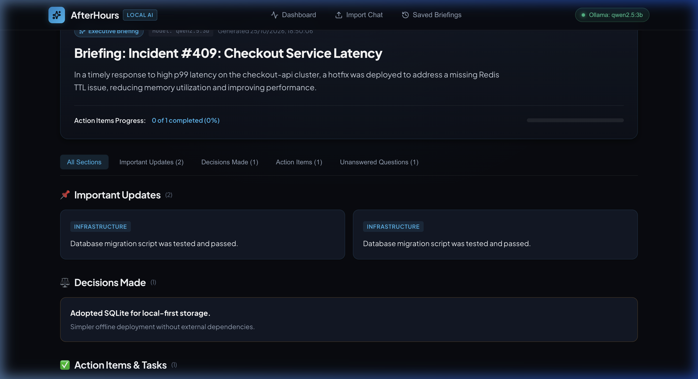
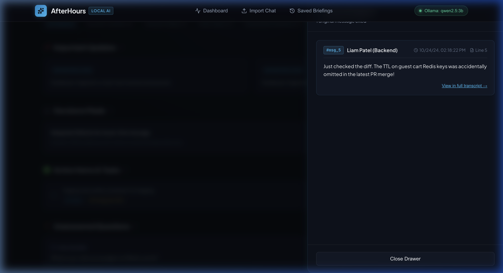
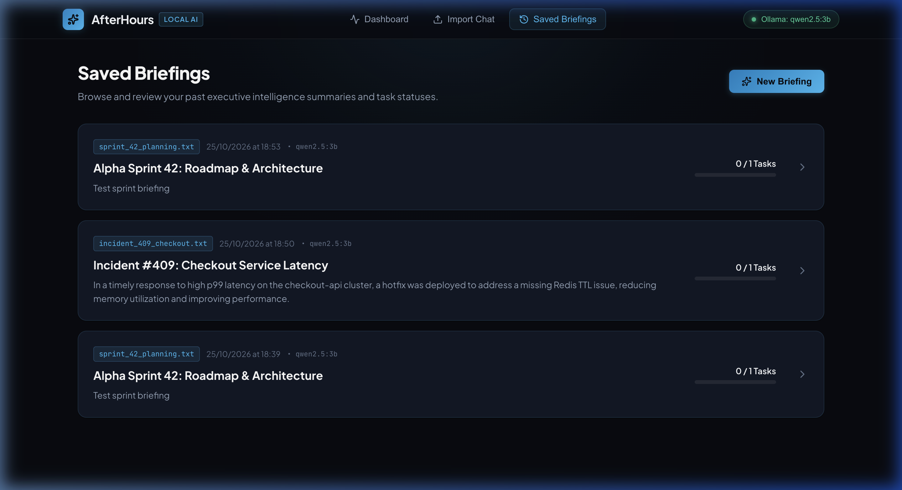

# AfterHours

> **"Your conversations. One useful briefing."**

[](https://www.python.org/)
[](https://fastapi.tiangolo.com/)
[](https://react.dev/)
[](https://ollama.com/)
[](https://opensource.org/licenses/MIT)

**AfterHours** is a local-first AI assistant that turns busy team chats into concise, actionable briefings.

Import a `.txt` chat export, review the parsed conversation, and generate a briefing covering key updates, decisions, action items, and unanswered questions—with citations linking back to the original messages.
---

## 🎬 Demo



---

## ✨ Key Features

- **Multi-Format Chat Export Parsing**: Automatically parses common timestamp and sender patterns from WhatsApp exports, Slack/Discord transcripts, and standard ISO server logs. Preserves line breaks, code snippets, and stack traces.
- **Strictly Grounded Local AI**: Inferences run exclusively against your local Ollama instance using **Qwen2.5 3B**. Strict Pydantic schema validation ensures the model never hallucinates arbitrary assignees, decisions, or dates.
- **Clickable Source Evidence Drawer**: Every briefing item is annotated with stable message IDs (e.g. `[#msg_5]`). Clicking any citation opens a slide-over drawer highlighting the exact raw message, sender avatar, timestamp, and line number.
- **Interactive Action Items & Persistence**: Action items are saved to local SQLite and can be checked off in real time; completion state persists across sessions.
- **Ollama Connection Diagnostics**: A live status indicator alerts you if the local Ollama daemon is offline or if the configured model is missing, offering 1-click copyable terminal commands to launch and pull the model.
- **Zero Cloud Leakage for Conversations**: Private conversation transcripts and generated summaries remain entirely within your local filesystem and local model runner.

---

## 📸 Screenshots

### 1. Dashboard & Instant Test Drive
Browse recent briefings, track key metrics, and launch realistic test-drive datasets in one click.


### 2. Message Preview & Inspector
Inspect parsed senders with color-coded avatars, timestamps, stable `#msg_` identifiers, and keyword search.


### 3. Generated Executive Briefing
Review the high-level executive summary, domain-categorized updates, decisions made, action items, and unanswered questions.


### 4. Clickable Source Evidence Drawer
Verify claims directly against the original chat transcript with line numbers and sender timestamps.


### 5. Saved Briefings History
Review past briefings with real-time task completion progress bars.


---

## 🏛️ Architecture

```
                    ┌───────────────────────────────┐
                    │  Chat Export (.txt / Paste)   │
                    └───────────────┬───────────────┘
                                    │
                                    ▼
                    ┌───────────────────────────────┐
                    │   Multi-Format Regex Parser   │
                    │   (assigns stable #msg_IDs)   │
                    └───────────────┬───────────────┘
                                    │
                         ┌──────────┴──────────┐
                         ▼                     ▼
             ┌───────────────────────┐   ┌───────────────────────┐
             │ Local SQLite Database │   │ Local Ollama Service  │
             │   (aiosqlite storage) │   │ (qwen2.5:3b via JSON) │
             └───────────┬───────────┘   └───────────┬───────────┘
                         │                           │
                         │   ┌───────────────────────┘
                         ▼   ▼
             ┌───────────────────────────────┐
             │  Pydantic v2 Schema Validator │
             │  (Grounding & Citation Check) │
             └───────────────┬───────────────┘
                             │
                             ▼
             ┌───────────────────────────────┐
             │    React + TypeScript UI      │
             │ (Cinematic Dark / Blue Theme) │
             └───────────────────────────────┘
```

---

## 🔒 Local-First Privacy Model: Exact Boundaries

AfterHours is engineered around user privacy, with the following technical boundaries:

1. **Conversation Data**:
   - Chat exports and generated briefings are stored **locally** in a SQLite database file (`afterhours.db` in your workspace).
   - No telemetry, analytics, or conversation data is transmitted to external servers.
2. **Inference Pipeline**:
   - AI generation runs exclusively via the local Ollama HTTP API (`http://localhost:11434/api/chat`).
   - The weights (`qwen2.5:3b`) run entirely on your local machine's GPU/CPU.
3. **Network Boundary Clarifications**:
   - **Initial Setup**: Internet access is required once to install dependencies (`pip install`, `npm install`) and pull the model (`ollama pull qwen2.5:3b`).
   - **Web Fonts**: The UI links Google Fonts (`Plus Jakarta Sans` and `JetBrains Mono`) for modern typography, with fallback system fonts if disconnected.
   - **Post-Setup**: Once installed and pulled, chat parsing, SQLite database storage, and AI inference execute completely locally without cloud APIs.

---

## 🚀 Setup & Installation Instructions

### Prerequisites
- **Python**: 3.9 or higher
- **Node.js**: 18+ and `npm`
- **Ollama**: Installed via [ollama.com](https://ollama.com) or `brew install ollama`

### 1. Start Ollama and Pull the Model
```bash
# Start the Ollama background service
ollama serve

# In a separate terminal, pull the 3B parameter model (~1.9 GB)
ollama pull qwen2.5:3b
```

### 2. Setup and Launch the Backend
```bash
cd backend

# Create and activate virtual environment
python3 -m venv venv
source venv/bin/activate

# Install dependencies
pip install -r requirements.txt

# Launch FastAPI server with auto-reload
./run.sh
```
*The backend starts at `http://127.0.0.1:8000` (Health check: `http://127.0.0.1:8000/api/health`).*

### 3. Setup and Launch the Frontend
In a new terminal window:
```bash
cd frontend

# Install frontend dependencies
npm install

# Start Vite development server
npm run dev
```
*The frontend will be available at `http://localhost:5173`.*

---

## 🧪 Verification & Testing

### Backend Test Suite (Pytest)
Run the 14 automated unit and integration tests covering multi-format chat parsing, Pydantic schema validation, and database task persistence:
```bash
cd backend
source venv/bin/activate
pytest
```
**Test Coverage Includes:**
- WhatsApp bracket timestamps (`[10/24/24, 09:15:32 AM]`)
- WhatsApp dash timestamps (`10/24/24, 9:15 AM - Alice:`)
- ISO 8601 timestamps (`2024-10-24 14:30:00 -`)
- Multi-line message continuation and stack trace preservation
- Pydantic schema rejection of malformed outputs
- Full REST API integration and SQLite task toggle persistence

### Frontend Production Build
Validate TypeScript types and production assets bundling:
```bash
cd frontend
npm run build
```

---

## 📁 Sample Datasets

Three fictional chat exports are included in the repository for immediate testing:
1. `samples/incident_409_checkout.txt`: Production incident postmortem covering latency alerts, missing Redis key TTL root cause, emergency hotfix assignment, and staging test postmortem.
2. `samples/sprint_42_planning.txt`: Architecture planning sync comparing IndexedDB (Dexie) vs SQLite WASM, migration timelines, and token refresh scope.
3. `samples/hackathon_sync.txt`: Hackathon team kickoff coordinating backend parsers, frontend design, and prompt engineering.

---

## ⚠️ Limitations & Future Work

- **Context Window Constraints**: The default `qwen2.5:3b` model runs with a standard context window. Extremely long conversations (over 10,000 messages) should be imported in chunks or day-long exports.
- **Export Format Scope**: Initial support is optimized for text exports (`.txt`). Proprietary encrypted database backups (e.g. raw `.db` WhatsApp crypt stores) must be exported to text first.
- **Hardware Requirements**: Running Qwen2.5 3B smoothly requires at least 4GB of free RAM and benefits significantly from Apple Silicon Unified Memory or a dedicated GPU.

---

## 📜 License

MIT License. Developed for local-first developer productivity.
